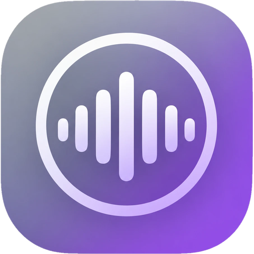

# Music

Un reproductor de música local pensado para el móvil, con diseño *Liquid Glass*,
y la herramienta para llenarlo. Sin dependencias en la parte web: HTML, CSS y JS a mano.

<p align="center"></p>

**Pruébala en el navegador:** https://pedrolumas.github.io/music/ (la versión web: sin
biblioteca propia, pero con Descubrir, muestras de 30 s, ajustes y todo el diseño).
Para tener tu música, instálala en tu PC como se explica abajo.

## Qué hace

- **Tres pestañas.** *Música* (canciones, artistas y listas, con buscador), *Descubrir*
  (recomendaciones y buscador de cualquier canción) y *Ajustes*.
- **Biblioteca y listas.** Las canciones salen de `music/pistas/`; una lista aparte es
  solo una etiqueta en la ficha de cada canción. Además, listas solas: *Favoritas*,
  *Recién añadidas*, *Lo que más escuchas* y *De Descubrir*.
- **Gestos.** Deslizar una canción a la derecha = suena a continuación; a la izquierda =
  borrar. Pulsación larga o `⋯` = menú. En "ahora suena": bajar para cerrar, a los lados
  para cambiar de canción, doble toque en la portada = favorita. Borde izquierdo = atrás.
- **"Ahora suena"** con el color de la portada, cola editable ("a continuación"),
  temporizador para dormir, aleatorio y repetir. Controles también en la pantalla de
  bloqueo del móvil (Media Session).
- **Descubrir.** Con la API pública de Deezer (sin clave): artistas parecidos a los tuyos y
  canciones tuyas que aún no tienes, con muestra de 30 s. Se renuevan solas cada 1, 3 o 7
  días, o con el botón. Lo que añades (`+`) queda guardado al momento y se descarga con
  *Descargar* o al cerrar la app, en un proceso aparte (`music/pedidos.py`). La descarga
  elige el vídeo que más se parece (duración, canal oficial, nada de "live" ni "cover") y
  pone la portada y los datos buenos del disco.
- **Sin servidor** (por ejemplo, publicada como web) la app sigue funcionando para escuchar
  y recomendar; lo elegido se guarda en el móvil y el botón *Enviar* manda la lista.
- **Letras sincronizadas** (LRCLIB): la línea que suena se ilumina; tocar una salta ahí.
- **Listas propias**: varias por canción, con su orden; se crean, renombran y borran en la app
  y, con servidor, se guardan en `music/.listas.json`.
- **Selección múltiple**: a una lista, a la cola, favoritas o borrar varias a la vez.
- **Perfil**: foto, nombre y saludo; "tu música en números" (tiempo escuchado, racha,
  última semana, tus artistas y canciones).
- **Español e inglés**, vibraciones (también en iPhone), fundidos al pausar, pantalla
  encendida con la letra, animaciones reducidas, calidad de descarga 192/320 y más en Ajustes.
- **Siete colores.** Medianoche, océano, orquídea, bosque, brasa, grafito y "portada"
  (toma los colores de lo que suena).
- **Borrar sin miedo.** Aviso con *Deshacer*. Lo borrado se mueve a `_CUARENTENA/music/`,
  no se destruye.
- **Servidor propio** (`music/servidor_music.py`) que solo sirve la carpeta `music/`,
  con soporte de `Range` (necesario para saltar dentro de una pista) y sin caché.

## Cómo se usa

Necesita Python 3.12+, [`yt-dlp`](https://github.com/yt-dlp/yt-dlp) y `ffmpeg`.

```bash
pip install yt-dlp

# abrir la app (ventana de móvil; en Windows, doble clic a Music.pyw)
python Music.pyw

# solo el servidor, en http://127.0.0.1:8935
python music/servidor_music.py

# abierto a la red local, para oírlo desde el móvil
python Music.pyw --lan
```

## Añadir música

```bash
python music/descargar_musica.py "Artista - Canción" "https://www.youtube.com/watch?v=..."
python music/descargar_musica.py --lista "Mi lista" "Artista - Canción"
python music/descargar_musica.py --pedidos     # lo elegido en Descubrir (lo hace la app sola)
```

Lo que no es una URL se busca en YouTube y se baja el primer resultado. Cada canción deja
tres ficheros con el id del vídeo: `.mp3`, `.jpg` (portada cuadrada) y `.json` (título,
artista y duración). Si un título sale mal limpiado, se corrige editando ese `.json`.

Una lista entera, en el formato que saca la app (`Artista - Canción [3:45]`, una sección
por lista), con la portada y el disco de Deezer y la versión que dura lo mismo:

```bash
python music/importar_lista.py lista.txt
```

## Tu música en el móvil, con contraseña

`publicar/` arma una copia de la app con tu música **cifrada** (AES-256-GCM, la clave sale
de tu contraseña con PBKDF2) para subirla a un repositorio público de GitHub Pages: en
abierto solo quedan la pantalla que pide la contraseña y el descifrador. Se pide una vez
por dispositivo y se puede instalar en la pantalla de inicio; lo ya escuchado suena sin conexión.

```bash
python publicar/construir.py --clave "tu frase"   # la primera vez (o para cambiarla)
python publicar/construir.py                      # tras añadir música
cd ~/mimusica && git add -A && git commit -m "Más música" && git push
```

Necesita Node (para cifrar). La contraseña queda en `publicar/clave.json`, que no se sube.

## Qué no incluye

La música. `music/pistas/` no se sube: este repositorio es el reproductor, no una
biblioteca. Descarga solo lo que tengas derecho a escuchar.

## Estructura

```
Music.pyw                  lanzador (ventana de móvil + servidor)
servidor.py                manejador HTTP con Range y sin caché
descargar_video.py         descargador de YouTube (vídeo o mp3)
generar_manifiesto.py      lo importa servidor.py
index.html                 la raíz de GitHub Pages: lleva a music/
music/
  index.html music.css music.js   la interfaz
  textos.js                       los textos, en español e inglés
  manifest.webmanifest            para instalarla en el móvil
  servidor_music.py               /pistas.json, /borrar, /restaurar, /api/...
  pedidos.py                      lo elegido en Descubrir y el descargador aparte
  descargar_musica.py             descarga + portada + ficha
  importar_lista.py               una lista de texto entera a la cola
  icono.*                         icono de la app
publicar/
  construir.py cifrar.mjs         la versión cifrada con tu música
  entrada.html sw.js              la pantalla de la contraseña y el descifrador
```
